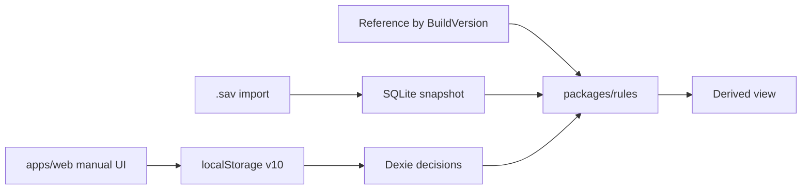

# Bridge plan: current Satisfactories → save-import spec

**Audit date:** 2026-11-27  
**Target spec:** Save File Import & Local-First Data Layer (draft dated 2026-11-22). Spec text was supplied for this audit; **`docs/specs/save-file-import-spec.md` is not in the repository**, not on `main`, and not in git history.  
**Branch audited:** `bridge-plan` (tip matches `main` at time of audit: `feef546`).  
**Method:** Read-only code inspection, `npm run dev` at `http://localhost:5173`, browser click-through of all screens.

---

## 1. TL;DR

- **Today:** Single-package Vite + React SPA; all factory data is hand-entered; persistence is `localStorage` envelope schema v10 plus optional JSON backup. No backend, no IndexedDB, no `.sav` parsing.
- **Map:** Custom percent pins on `/assets/map.jpg` (no Leaflet/MapLibre, no world-cm coordinates, no calibration transform).
- **vs spec:** The spec’s snapshot / derived / decision / draft layers are not implemented as separate stores; production lines, routes, and stations are manual save data, not derived from a belt graph.
- **Sync:** S3/Lambda owner sync from older design documents is **absent** in code and infra (`enable_api = false` in `terraform/main.tf`; no `fetch` in `src/`).
- **Phase 1 path (recommendation):** pnpm monorepo strangler → extract `packages/model` → SQLite snapshot + Dexie decisions + gzip export alongside today’s UI; defer polygons, manifold rules, and retiring manual editors until a `.sav` can hydrate a snapshot.

---

## 2. Current state inventory

Facts below are **observed in code** unless labeled **inference** or **recommendation**.

### 2.1 Repository layout and tooling

| Area | Observation | Evidence |
| --- | --- | --- |
| Package manager | **npm** (`package-lock.json`) | Root `package.json`, `.github/workflows/deploy.yml` (`npm ci`) |
| Structure | Flat app at repo root: `src/`, `public/`, `scripts/`, `docs/`, `terraform/`, `.github/` | Directory listing |
| Build | Vite 6 + `@vitejs/plugin-react` | `vite.config.ts` |
| TypeScript | `strict: true`, `noEmit: true`, `include: ["src"]` | `tsconfig.json` |
| Lint / format | **Absent** (no ESLint, Prettier, or format script) | `package.json` scripts |
| Tests | `npm test` → `node scripts/check-line-feeds.mjs` (model/state SSR via Vite middleware; no React render) | `scripts/check-line-feeds.mjs` |
| Dependencies (runtime) | `react`, `react-dom`, `recharts`, `zod` | `package.json` |
| Routing | **No react-router.** Screen string union; conditional render in `App.tsx` | `src/types.ts` (`Screen`), `src/App.tsx` |
| Git branch | `rebirth` exists locally; not inspected for divergence from `main` | `git branch -a` |

**Scripts**

```6:11:package.json
  "scripts": {
    "test": "node scripts/check-line-feeds.mjs",
    "dev": "vite",
    "build": "tsc --noEmit && vite build",
    "preview": "vite preview"
  },
```

### 2.2 Screens and navigation

Screens: `map | factory | factories | rollup | reference | worlds` (`src/types.ts`).

| Screen | Nav label | Requires active world? | Primary purpose |
| --- | --- | --- | --- |
| `worlds` | Worlds | No | CRUD worlds, sample template, JSON backup |
| `map` | Map | Yes | Factory pins, route lines, filters, sidebar editing |
| `factory` | *(not in nav)* | Yes | Production editor, commit/reset, logistics panel |
| `factories` | Factories | Yes | Factory cards, metadata edit, open production |
| `rollup` | Resources | Yes | World resource balances, favorites, filters, metrics |
| `reference` | Reference | No | Items / recipes wiki (uses world totals when active) |

`NavRail.tsx` disables Map, Factories, Resources when no world is selected. Header provides world switcher and breadcrumbs (`Header.tsx`).

**Global modals** (mounted in `App.tsx`): `FactoryModal`, `RouteModal`, `LocalInputModal`, `AddExportResourceModal`, `AddReceivingStationModal`, `StationEditModal`, `DrillDrawer`.

### 2.3 State management

- **Pattern:** React Context + `useState` in `StoreProvider` (`src/state/store.tsx`). Not Zustand, Redux, or `useReducer`.
- **Persisted fields:** `worlds`, `worldId`, `favItems`, `favFactories`. Autosaved to `localStorage` on change.
- **Ephemeral fields:** `screen`, selection/focus, map hover/lock, filters, all modal state, `picker`, `refSel`, etc.
- **World mutation:** `mutateWorld(fn)` deep-clones `worlds`, applies `fn`, `touchWorld` updates `updatedAt`.
- **Command surface:** `useActions()` exposes named handlers (create factory, routes, stations, backup, commit, reset, …). Some UI still calls `mutateWorld` directly (e.g. allocation edits in `ProductionLineConnections.tsx`).

### 2.4 Data model (persisted)

Source of truth: Zod schemas in `src/model/schema.ts` (`SCHEMA_VERSION = 10`). Re-exported from `src/types.ts`.

#### Envelope: `PersistedStateV2`

| Field | Type | Notes |
| --- | --- | --- |
| `schemaVersion` | `10` | Literal |
| `worlds` | `World[]` | |
| `worldId` | `string \| null` | Active world |
| `favItems` | `string[]` | Global resource favorites (item **names**) |
| `favFactories` | `string[]` | Global factory favorites (default `[]` since v6) |

#### `World`

| Field | Type | Default / notes |
| --- | --- | --- |
| `id` | `string` | `w_<time>_<counter>` (`src/model/world.ts`) |
| `name` | `string` | |
| `factories` | `Factory[]` | |
| `routes` | `Route[]` | Belt/pipe and legacy inter-factory legs (train/truck/drone migrated to stations) |
| `stations` | `Station[]` | `[]` |
| `resourceMetricHistory` | `ResourceMetricSnapshot[]` | `[]`; snapshots on explicit factory **commit** only |
| `createdAt`, `updatedAt` | ISO strings | |

**Not present:** `SaveIdentifier`, `SaveDataHash`, floors, machine keys, polygons, notes/todos, drafts separate from baseline.

#### `Factory`

| Field | Type | Notes |
| --- | --- | --- |
| `id`, `name`, `color` | strings | Create uses `f_${Date.now()}` |
| `status` | `planned \| construction \| operational \| decommissioned` | |
| `tier` | string | UI labels e.g. "Mid-sized Factory" (`gameData.ts` `TYPES`) — not schema-enforced |
| `tagline`, `tags[]`, `cover` | | `cover` can be URL for CSS background |
| `x`, `y` | number | **Map position in percent** of map image (0–100) |
| `sections` | `Section[]` | Production categories |
| `localInputs` | `LocalInput[]` | On-site miners / pipes, manual rates |
| `importOrder`, `exportOrder` | `string[]` | Display order for flow sidebar |
| `favoriteItems` | `string[]` optional | Per-factory resource pins |
| `stationSeq` | number | Monotonic station naming; default `0` |
| `baseline` | string | JSON string of `FactoryBaseline` |

#### `Section` → `Row` (production line)

| Entity | Fields |
| --- | --- |
| `Section` | `id`, `name`, `rows[]` |
| `Row` | `id`, `name` (default `''`), `recipeId`, `count` (machines), `allocations[]`, `sources[]`, `destinations[]` (legacy, migrated to allocations) |
| `OutputAllocation` | `id`, `item`, `rate`, `kind: line \| factory \| review`, `targetId`, optional `transport`, optional `reviewFor` |
| `RowSource` | `local` + `localInputId` + optional `rate`, or `import` + `item` + optional `rate` |
| `RowDestination` | Legacy `section` or `export`; upgraded away by `upgradeProduction` |

#### `LocalInput`

`id`, `item`, `rate`, `t: Transport` (`Belt`, `Pipe`, etc.).

#### `Route`

`id`, `from`, `to` (factory ids), `item`, `rate`, `t: Transport`. **Authored** belt/pipe (and historically train/truck/drone before migration).

#### `Station` / `Vehicle`

| Entity | Fields |
| --- | --- |
| `Station` | `id`, `name`, `type: train \| truck \| drone`, `homeFactoryId`, `resourceId`, `role: export \| import`, `totalRate`, `vehicles[]` |
| `Vehicle` | `id`, `type`, `destinationStationId` (nullable, **single destination**), `perVehicleRate` |

#### `ResourceMetricSnapshot`

Per commit: `factoryId`, `factoryName`, `savedAt`, `values: Record<item, { produced, consumed, efficiency }>` (world-wide effective rates at commit time).

#### Baseline vs working (`src/model/baseline.ts`)

`FactoryBaseline` = snapshot of `sections`, `localInputs`, `importOrder`, `exportOrder`, **outbound** `routes`, **owned** `stations`. Factory identity, map position, favorites, and `stationSeq` are **not** in baseline. **Commit** writes baseline + appends metric snapshot. **Reset** restores baseline into working state. **Autosave** persists working state (including uncommitted edits).

### 2.5 Persistence and network

| Mechanism | Key / format | Behavior |
| --- | --- | --- |
| Primary save | `localStorage` `satisfactories:v2` | Full envelope JSON |
| Legacy read | `satisfactories:v1` | Read-only fallback; same envelope shape |
| Backup file | `satisfactories-backup-YYYY-MM-DD.json` | Same envelope; **load replaces all worlds and favorites** |
| Last backup time | `satisfactories:last-backup-at` | ISO timestamp |
| Layout | `sf:layout:` + panel id | Split pane widths/open state (`usePersistedLayout.ts`) |
| IndexedDB | **Absent** | Searched `src/` |
| HTTP API / sync | **Absent in app** | No `fetch`, `VITE_SYNC_URL`, bearer tokens in `src/` |
| S3/Lambda user data | **Not built** | `terraform/main.tf` `enable_api = false`, `enable_dynamodb = false` |

Schema comment at `PersistedStateSchema` still says “localStorage now, database later” (`schema.ts` ~136) — describes intent from pre-spec era, not implemented backend.

**Migrations** (`src/model/migrations.ts`): unversioned → 2 … → 8 → **10** (v8 handler sets `SCHEMA_VERSION` directly to 10; v9→10 `upgradeProduction` runs only when loaded save already says `schemaVersion === 9`). v6→7 migrates Train/Truck/Drone `routes` into `stations` + vehicles.

### 2.6 Map stack

| Topic | Observation |
| --- | --- |
| Library | **Custom** DOM + `` + SVG overlay. No Leaflet, MapLibre, canvas WebGL. |
| Image | `public/assets/map.jpg` (`MapScreen.tsx`) |
| Coordinates | **Percent** of map element: `left: f.x%`, `top: f.y%`; drag clamps 2.5–97.5; stored rounded to 2 decimals (`store.tsx` `movePin`) |
| Routes | SVG `viewBox="0 0 100 100"` using same percent coords |
| Camera | `useMapCamera.ts`: zoom 1–4, pan in px, per-`worldId` ref (not persisted) |
| World cm / calibration | **Absent** |
| Factory shape | Point pin, not polygon |

### 2.7 Game data pipeline

| Topic | Observation |
| --- | --- |
| File | `src/data/satisfactory-game-data.json` (~137 KB, checked in) |
| `meta.source` | `"Satisfactory Docs.json via greeny/SatisfactoryTools parse (Update 1.0+/1.x)"` |
| Contents | 152 items (`color`, `cat` only), 11 buildings (`power`, `glyph`), 276 recipes (`id`, `building`, `power`, I/O, `alt`) |
| Transformer | **None** at runtime — `gameData.ts` assigns JSON to exports |
| Generator script | **Absent** in repo (`scripts/` only `check-line-feeds.mjs`, `bootstrap.sh`) |
| Unlocks | `resource-unlocks.json` + `resourceTiers.ts` (greeny 1.0 schematics comment) |
| BuildVersion keying | **Absent** — single static `meta.version` `"1.0.0"` |
| Item keys | Display **names**, not game `classPath` — cannot join save actors as-is |

### 2.8 Derived calculations (not persisted)

| Concern | Module | Role |
| --- | --- | --- |
| Nameplate / effective rates, rollup | `src/state/derive.ts` | `aggregate`, `aggregateEffective`, `rollupWorld` |
| Line feed convergence, efficiencies | `src/state/lineFeeds.ts` | Iterative delivery / import claims |
| Input supply validation | `src/state/inputSupply.ts` | Claim rates vs availability |
| Flow sidebar ordering | `src/state/flows.ts` | `buildFlows` from routes, stations, allocations |
| Map connection keys | `src/model/mapConnections.ts` | Lines between factories |
| Logistics / stations | `src/model/logistics.ts` | Station CRUD, vehicle rates, legacy route delivery |
| Commit metrics | `src/state/resourceMetrics.ts` | Snapshot on commit |

These functions implement the **manual** graph (rows, routes, stations), not spec §6 manifold walk on save components.

### 2.9 PWA

`vite-plugin-pwa` in `vite.config.ts`:

- `registerType: 'autoUpdate'` (spec recommends `prompt`)
- Manifest: `Satisfactories`, `standalone`, theme `#0B0C0F`, icons 192/512/maskable
- Workbox: `navigateFallback: '/index.html'`, `globPatterns: '**/*.{js,css,html,ico,png,woff2}'` — **`map.jpg` not in precache glob**
- `main.tsx` calls `registerSW({ immediate: true })`

Icons present under `public/` (favicon, apple-touch, og-image, etc.).

### 2.10 Deploy and infrastructure

**CI** (`.github/workflows/deploy.yml`):

- Trigger: push to `main`, `workflow_dispatch`
- Node 20, `npm ci`, `npm run build` → **`dist/`**
- OIDC → `aws s3 sync dist s3://$S3_BUCKET --delete`
- CloudFront invalidation `/*`
- Vars: `AWS_DEPLOY_ROLE_ARN`, `AWS_REGION`, `S3_BUCKET`, `CLOUDFRONT_DISTRIBUTION_ID`

**Terraform** (`terraform/main.tf`): shared `static-site` module, `spa_mode = true`, API/Dynamo **off**. `scripts/bootstrap.sh` writes GitHub vars from terraform outputs; does not deploy content.

### 2.11 Features in flight / incomplete

| Area | Status |
| --- | --- |
| Stations & vehicles | **Shipped** on factory screen: export/import stations, vehicles, modals, migration from old routes. Map/Factories sidebars: belt/pipe + flows only; **no station editor on map** |
| Multi-destination trains | **Not supported** — one `destinationStationId` per vehicle |
| Factory delete | **Absent** |
| Notes / todos per factory | **Absent** in schema (discussed in past chats, not built) |
| Power plant factory type | **Absent** |
| `DrillDrawer` | Mounted but **`drillItem` never set** — drawer unreachable |
| `addFlowLeg` in `useActions` | **No callers** |
| `TODO`/`FIXME` in source | **None** found |

**Sample world:** `src/data/templates/northern-stretch.json` — 6 factories, 7 routes (train/truck/drone + belt/pipe), no `stations` key; `instantiateTemplate` normalizes routes → stations.

---

## 3. What I saw running the app

**Environment:** `npm run dev` → `http://localhost:5173/` (Vite 6.4.3). Fresh profile (no prior `localStorage`).

| Step | Observation |
| --- | --- |
| Boot | Lands on **Worlds**; Map/Factories/Resources nav disabled until a world exists |
| Load sample world | **Northern Stretch** activates; navigates to **Map** with 6 pins, status/tag filters, zoom controls, **＋ Factory** |
| Map | World name in header dropdown; filter chips (All / Operational / Building / Planned, tag chips Iron, Copper, …) |
| Factories | Six cards with **Edit**, **Open production →**; no delete |
| Factory (Cygnus) | **↺ Reset**, **✓ Commit**; production lines with machine counts; resource balance rows; right panel: **Add local input**, **Add receiving station**, **Add Resource**, export list removals |
| Resources | 24 items in world; search, filters (unlock tier, scope, tag, balance), sort; **Resource metrics** accordion; favorite toggles |
| Reference | Search items; detail panel (default item visible); works with active world |
| Worlds | **New world**, **Load sample**, **Save backup**, **Load backup** (duplicate buttons in layout) |

**Not exercised in browser session (code supports):** pin drag, route hover, commit/reset round-trip, station modal full flow, JSON backup file picker, mobile viewport, `npm run preview` / service worker update behavior.

---

## 4. Current → target mapping

Target layers from spec §2: **snapshot** | **reference** | **derived** | **decision** | **draft**.

### 4.1 Worlds and identity

| Current concept | File(s) | Target layer | Action | Notes |
| --- | --- | --- | --- | --- |
| `World.id` (`w_*`) | `schema.ts`, `world.ts` | decision (legacy) | **migrate** | Map to `SaveIdentifier` when `.sav` linked; hand-built worlds stay decision-only |
| `World.name` | `schema.ts` | decision | **keep** | May mirror `sessionName` from save |
| `createdAt` / `updatedAt` | `schema.ts` | decision / meta | **keep** | App metadata |
| `resourceMetricHistory` | `schema.ts`, `resourceMetrics.ts` | decision (extension) | **keep** * | Spec silent; **recommendation:** treat as decision analytics, not snapshot |
| Multi-world list | `store.tsx`, `WorldsScreen.tsx` | decision index | **keep** | Spec §14 open; **recommendation:** Dexie index + one SQLite DB per `SaveIdentifier` |

\* = recommended spec deviation (see §9).

### 4.2 Factories and map

| Current concept | File(s) | Target layer | Action | Notes |
| --- | --- | --- | --- | --- |
| Factory pin `x`, `y` (percent) | `schema.ts`, `MapScreen.tsx` | decision (legacy pin) | **migrate** | Store as `legacyPinPercent`; **do not** auto-convert to world cm without calibration |
| Factory polygon | — | decision | **replace** pin | Spec §4: vertices in world cm |
| `name`, `color`, `status`, `tier`, `tagline`, `tags`, `cover` | `schema.ts` | decision | **keep** | Editorial / planning metadata |
| `favoriteItems` | `schema.ts` | decision | **keep** | |
| Machine membership | — | derived + decision overrides | **replace** | Point-in-polygon + include/exclude keys (spec §4) |
| Floors | — | derived + decision settings | **missing → add** | Spec §5 |

### 4.3 Production structure

| Current concept | File(s) | Target layer | Action | Notes |
| --- | --- | --- | --- | --- |
| `Section` (category) | `schema.ts` | decision (optional label) | **migrate** | Spec lines are manifold-based; sections become labels on confirmed lines |
| `Row` (`recipeId`, `count`) | `schema.ts` | derived → decision when confirmed | **replace** authoring | Snapshot has machines; lines derived then **confirmLine** |
| `OutputAllocation` | `schema.ts` | derived / decision | **replace** | Spec: line inputs/outputs from manifolds + confirmed links |
| `RowSource` (local/import claims) | `schema.ts` | derived | **replace** | Local nodes from save extractors; imports from transport derivation |
| `destinations` (legacy) | `schema.ts`, `production.ts` | — | **delete** (already emptied on upgrade) | |

### 4.4 Logistics

| Current concept | File(s) | Target layer | Action | Notes |
| --- | --- | --- | --- | --- |
| `localInputs` | `schema.ts` | snapshot + decision | **replace** manual entry | Rates from extractors / user override |
| `Route` (belt/pipe) | `schema.ts` | derived | **replace** | Graph from save connections; keep editor only until derivation works |
| `Station` / `Vehicle` | `schema.ts`, `logistics.ts` | derived | **replace** manual authoring | Spec §7: timetables, platforms, drone ports |
| `importOrder` / `exportOrder` | `schema.ts` | decision | **keep** | Display order for flows UI |
| `buildFlows` / map lines | `flows.ts`, `mapConnections.ts` | derived view | **recompute** | Input changes from snapshot + decisions |

### 4.5 Baseline, commit, backup

| Current concept | File(s) | Target layer | Action | Notes |
| --- | --- | --- | --- | --- |
| `factory.baseline` JSON | `baseline.ts` | draft (precursor) | **replace** | Spec: command log + named drafts |
| Commit / Reset | `store.tsx`, `baseline.ts` | decision commands | **replace mechanism** | **keep** UX idea via `saveDraft` / restore + audit |
| JSON backup envelope | `backup.ts` | export format | **migrate** | → `.satisfactories.json.gz` (spec §10); `.sav` import replaces **snapshot only** |
| `favItems`, `favFactories` | `schema.ts` | decision | **keep** | |

### 4.6 Reference data

| Current concept | File(s) | Target layer | Action | Notes |
| --- | --- | --- | --- | --- |
| `satisfactory-game-data.json` | `src/data/` | reference | **migrate** | `packages/reference`, keyed by `BuildVersion` |
| `resource-unlocks.json` | `src/data/` | reference | **keep** / merge | Part of reference bundle |
| Reference screen | `ReferenceScreen.tsx` | UI on reference | **keep** | Join to snapshot for live rates later |

### 4.7 Coordinates and migration of existing browser data

| Data | Migration path |
| --- | --- |
| `satisfactories:v2` on production origin | On first boot of new stack: import envelope into **Dexie decisions** as legacy worlds; no snapshot until user imports `.sav` or stays manual-only |
| Percent pins | Preserve as legacy; polygons drawn fresh or from markers (spec §12 nice-to-have) |
| Recipe rows without machine keys | Land in **audit tray** after first save import |
| `sf:layout:*` | Unchanged |
| Cutover | Do not remove `localStorage` key until gzip export round-trip verified |

---

## 5. Gap analysis by spec section

| Spec § | Status | Evidence |
| --- | --- | --- |
| **§1 Goal** | **Partial** | Static SPA + planner exist. No `.sav` read, no reconcile on re-import, no offline snapshot store beyond PWA shell |
| **§2 Four layers** | **Missing** (as storage) | Single blob envelope; reference JSON bundled; `derive.ts`/`lineFeeds.ts` are pure but over manual data; no audit tray or drafts |
| **§3 Hierarchy** | **Conflict** | World → factory (point) → section → row, not save → polygon factory → floor → machine-keyed line |
| **§4 Polygons / world cm** | **Missing** | Percent pins only (`FactorySchema` `x`,`y`; `MapScreen` %) |
| **§5 Floors** | **Missing** | No Z clustering or floor filter |
| **§6 Manifold lines** | **Missing** | User-authored rows; no `mConnectedComponent` graph |
| **§7 Transport** | **Conflict** | Manual stations/vehicles implemented; no timetable/drone/truck path derivation |
| **§8 Re-import & audit** | **Missing** | Backup replaces all; no `SaveIdentifier`/`SaveDataHash`; no diff/orphans/audit UI |
| **§9 Standard data layer** | **Partial** | Zod for v10 envelope; `useActions` names many writes; no command log, no unified read API, no SQL DDL |
| **§10 Storage & engine** | **Mostly missing** | PWA + JSON backup FS API only; no SQLite-WASM, Dexie, parser worker, `DecompressionStream` |
| **§11 Repo layout** | **Missing** | Single npm package; CI assumes root `dist/` |
| **§12 Validation plan** | **Missing** | No `fixtures/`, no `.sav`, no golden derived snapshots |
| **§13 Deep-dive questions** | **This document** | — |
| **§14 Open questions** | **Open** | Draft merge, DB-per-world vs keyed, raw `.sav` retention, transport rate formula — not resolved in code |

### Conflicts (current code vs spec)

1. **Percent coordinates vs world cm** (`schema.ts`, `MapScreen.tsx`).
2. **Point factories vs vector polygons** (spec §4).
3. **Manual production graph vs derived snapshot** (sections/rows/routes/stations).
4. **One localStorage document vs snapshot/decisions split**.
5. **Load backup replaces everything vs `.sav` replaces snapshot only** (`backup.ts`).
6. **PWA `autoUpdate` vs `prompt`** (`vite.config.ts`).
7. **Comments / older docs** implying future DB/Lambda vs spec “no backend” (schema comment; terraform output for unused Lambda).
8. **Item display names vs `classPath`** in reference JSON.

---

## 6. Bridge plan (ordered steps)

**Phase 1 boundary (per spec next step):** monorepo, model package, SQLite snapshot store, export/import — **without** removing manual UI, polygons, manifold rules, or WebGL map.

### Step 1 — pnpm workspace + `apps/web` + CI

| | |
| --- | --- |
| **Goal** | Monorepo shell; deploy still ships static SPA |
| **Moves** | `src/`, `public/`, `index.html`, `vite.config.ts`, app `tsconfig`, deps → `apps/web/`; root `pnpm-workspace.yaml`; keep `docs/`, `terraform/`, `.github/` |
| **CI** | `pnpm install --frozen-lockfile`; `pnpm --filter web build`; `aws s3 sync apps/web/dist` |
| **Risk** | Wrong sync path → empty site |
| **Verify** | `pnpm test`, `pnpm build`, workflow dry-run paths |

### Step 2 — `packages/model`

| | |
| --- | --- |
| **Goal** | Extract current persisted types and migrations unchanged |
| **Moves** | `schema`, `migrations`, `baseline`, `backup`, `world`, `logistics`, `production`, `mapConnections` → `packages/model` |
| **Risk** | Low if re-exports preserve paths |
| **Verify** | `scripts/check-line-feeds.mjs` green |

### Step 3 — Layer schemas (additive)

| | |
| --- | --- |
| **Goal** | Zod + TypeScript for snapshot, decisions, drafts, commands; SQL DDL for snapshot tables |
| **Files** | New under `packages/model` (or split `packages/snapshot-schema`) |
| **Risk** | Schema churn — version early |
| **Verify** | Unit parse tests; v9 backup fixture migrates |

### Step 4 — SQLite-WASM snapshot adapter

| | |
| --- | --- |
| **Goal** | DB worker + `opfs-sahpool`; read/write empty or fixture snapshot |
| **Risk** | OPFS browser support; worker bundling |
| **Verify** | Chromium dev + preview; insert/query smoke test |

### Step 5 — Dexie decisions + `.satisfactories.json.gz`

| | |
| --- | --- |
| **Goal** | Dual-write with `satisfactories:v2`; file export/import per spec §10 |
| **Risk** | Data loss on cutover |
| **Verify** | Northern Stretch + manual v9 envelope round-trip; clear site data → import restores |

### Step 6 — `packages/sav-parser` worker

| | |
| --- | --- |
| **Goal** | Fork `@etothepii/satisfactory-file-parser`; header hash short-circuit; write snapshot transaction; **do not** overwrite decisions |
| **Blocked** | No `.sav` in repo — need `fixtures/` (Git LFS) |
| **Verify** | Spec §12 go/no-go (~15 s, ~2 GB); platform mode / timetable reads on 1.2 save |

### Later (post–Phase 1)

- `packages/reference` — Docs normalizer, `BuildVersion` bundles
- `packages/rules` — manifolds, floors, transport, reconciliation, rates
- Map: affine `worldToImage` / `imageToWorld`, polygon draw (Leaflet+Geoman vs MapLibre+Terra Draw — **decision deferred**)
- Audit tray UI; retire manual row/route/station editors when derived path covers Northern Stretch + real save



### Monorepo move list (concrete)

| From (today) | To (target) |
| --- | --- |
| `src/**` | `apps/web/src/**` |
| `public/**` | `apps/web/public/**` |
| `index.html` | `apps/web/index.html` |
| `vite.config.ts` | `apps/web/vite.config.ts` |
| `src/model/**` | `packages/model/src/**` (step 2) |
| `src/state/derive.ts`, `lineFeeds.ts`, … | `packages/rules` (later) |
| `src/data/satisfactory-game-data.json` | `packages/reference/data/` (later) |
| `scripts/check-line-feeds.mjs` | Root or `apps/web` with updated import paths |
| `fixtures/` | **New** (Git LFS) |
| `docs/specs/save-file-import-spec.md` | **Add to repo** (currently external draft) |

**Deploy impact:** Only build output path and package manager in `.github/workflows/deploy.yml`. Terraform unchanged.

---

## 7. Parallel vs serial work

| Serial (must order) | Reason |
| --- | --- |
| Step 1 before 2–6 | Package paths and CI |
| Step 3 before 4–5 | Snapshot DDL before adapters |
| Step 5 before localStorage cutover | Proven export round-trip |
| Derived transport UI before deleting station editors | Avoid feature regression |

| Parallel (after step 1) | Notes |
| --- | --- |
| Parser spike (`packages/sav-parser`) | Until SQL write API stable |
| Docs normalizer (`packages/reference`) | Independent of UI |
| Map calibration measurements | Image pixels vs wiki bounds; no code dependency |
| Steps 4 vs 5 on separate branches | After step 3 schemas |

---

## 8. Pause / delete list

### Pause (do not expand until save-driven path exists)

- Multi-stop train timetables in **manual** model
- Station editing on **map** sidebar (factory screen only today)
- Power-plant factory type and world power rollup
- Notes/todos fields without command-log / decision design
- New manual logistics features from 2026 backlog chats

### Do not delete in Phase 1

- Station/vehicle UI, belt/pipe routes, recipe rows, Northern Stretch template, `localStorage` v10 read path

### Safe to remove later (cleanup PR)

- `addFlowLeg` (unused)
- `DrillDrawer` (unreachable)
- Train/Truck/Drone **route** authoring (already migrated to stations on load)

### Do not build

- Lambda/Dynamo owner sync (terraform already off)
- Bearer token / `VITE_SYNC_URL` client

---

## 9. Risks, unknowns, recommended spec deviations

### Unknowns (do not guess)

| Topic | What would resolve it |
| --- | --- |
| Parser performance on Rob’s save | `.sav` in `fixtures/` + §12 benchmarks |
| 1.2 platform load/unload, timetables, drone destinations | Parse real 1.2 save in worker |
| In-game map markers in save | Parser inspection + §12 nice-to-have |
| Affine map calibration | Map image dimensions + known in-game marker positions |
| Production `satisfactories:v1` users | Analytics or support feedback |
| `@etothepii/satisfactory-file-parser` 1.2 coverage | Fork spike |
| Exact `BuildVersion` for reference bundle | Header read from save |

### Risks

| Risk | Mitigation |
| --- | --- |
| OPFS eviction (Safari) | Spec export reminders; gzip backup before cutover |
| Monorepo breaks deploy | Step 1 checklist on sync path |
| Dual-write drift (localStorage vs Dexie) | Feature flag; single writer after step 5 |
| AGPL parser temptation | Stay MIT fork; Rust only if budget miss |
| Converting percent pins to cm wrongly | Never auto-convert; legacy field |

### Recommended spec deviations (explicit)

| Deviation | Rationale |
| --- | --- |
| **Strangler Phase 1** | Keep manual UI until snapshot + import work |
| **Retain percent map until polygons** | No calibration exists |
| **Keep `resourceMetricHistory` + favorites as decisions** | Spec §2 silent; avoids discarding user value |
| **One SQLite DB per `SaveIdentifier`, Dexie world index** | Matches current multi-world screen; resolves §14 partially |
| **Defer PWA `prompt` + runtime map cache** | Low risk until large assets in snapshot path |
| **Incremental command log** | Do not rewrite all `mutateWorld` paths in Phase 1 |
| **Leaflet vs MapLibre** | Defer to Phase 2 map PR after calibration spike |

---

## 10. Appendix: spec §13 checklist (deep-dive answers)

| Question | Answer |
| --- | --- |
| Factories, sections, rows, routes, stations vs §2–§7 | See §4 mapping tables |
| Persistence / S3 / Lambda | localStorage + JSON only; sync **absent** |
| Map stack / coordinates | Custom percent; no world cm |
| Game data pipeline | greeny/Docs subset; not BuildVersion-keyed |
| Manual vs decision vs derived | Manual rows/routes/stations → derived; metadata/favorites/orders → decision |
| GitHub Actions / monorepo | Root `npm ci` + `dist/` today; change sync path after move |
| PWA | Present; `autoUpdate`; map.jpg not precached |
| Half-built features | Stations shipped manually; notes/power/multi-stop trains not in schema |

---

*End of bridge plan. Next action: add `docs/specs/save-file-import-spec.md` to the repo and open Phase 1 Step 1 PR.*